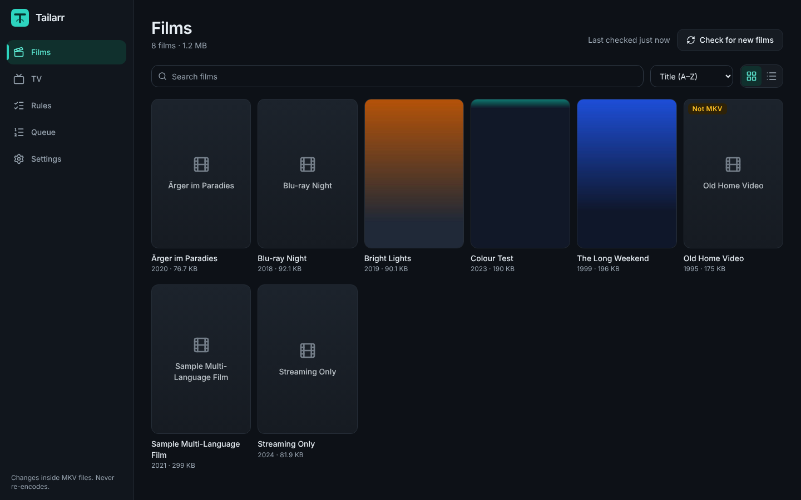
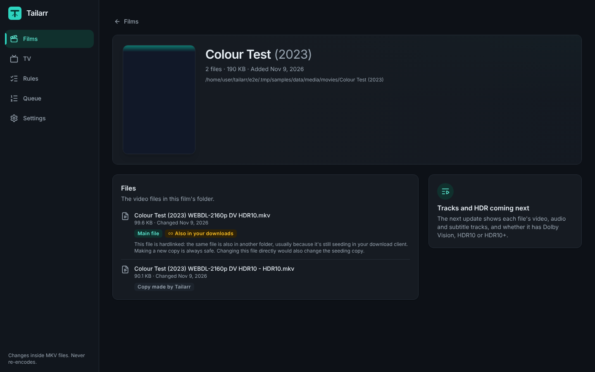
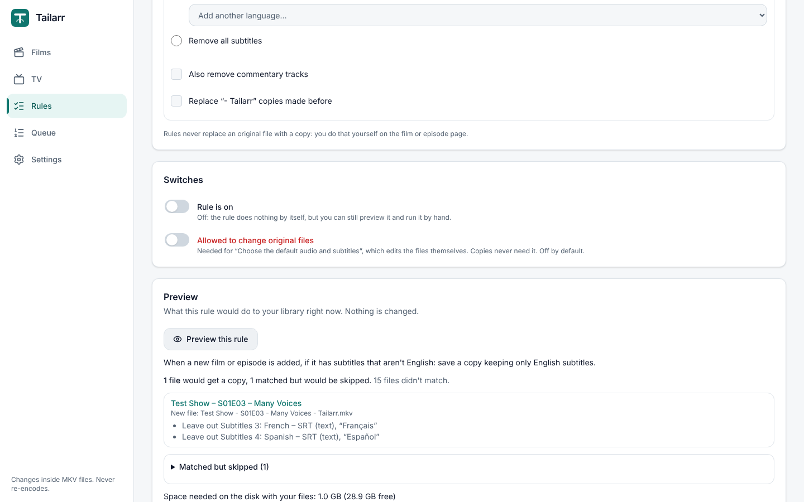
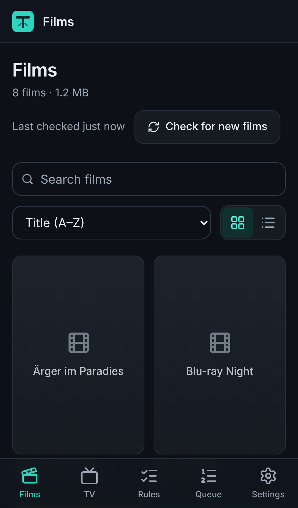

# Tailarr

**Tailor your media to suit your players.**

Tailarr is a self-hosted web app that changes what's *inside* your MKV films and TV
episodes (audio and subtitle tracks, which ones play by default, track names, and Dolby
Vision) **without ever re-encoding** the picture or sound. It's a friendly front-end for
[MKVToolNix](https://mkvtoolnix.download/) and
[dovi_tool](https://github.com/quietvoid/dovi_tool), made to sit next to Radarr, Sonarr
and Plex on an Unraid server.



## Why you might want it

- **Your TV shows Dolby Vision films with purple or green colours.** Tailarr makes an
  HDR10 copy next to the original (`Film - HDR10.mkv`). Plex shows both as versions of
  one film, so each device plays the one that suits it.
- **Films come with a dozen audio and subtitle tracks you never use**, or the wrong
  one plays by default. Untick them, or pick the default, in a couple of clicks.
- **You'd like it to happen by itself.** Rules such as "if a new film has Dolby Vision,
  make an HDR10 copy" run when Radarr or Sonarr add a film or episode.

Everything happens in a web page that works on a computer or a phone, in plain English,
with a summary to confirm before anything changes.

## What it does

- **Browse** your films and TV shows (show → season → episode) with posters, and see
  what's inside every file: video, audio and subtitle tracks in plain words ("Dolby
  TrueHD Atmos 7.1", "English, forced"), chapters, and HDR (Dolby Vision with its
  profile, HDR10, HDR10+, HLG).
- **Make a copy without Dolby Vision** (`Film - HDR10.mkv`) for TVs and players that
  show Dolby Vision with the wrong colours. All audio, subtitles, chapters and the exact
  frame rate are kept. (Profile 5 is refused: it has no HDR10 picture underneath.)
- **Save a copy without some tracks** (`Film - Tailarr.mkv`): untick the audio or
  subtitle tracks you don't want. Tick **Also remove Dolby Vision** to do both in one go.
- **Change track settings** (default / forced / names) in the file itself.
- **Replace the original with a copy**, with the original kept in a hidden recycle
  folder for 30 days, and a **Restore** button to undo it.
- **Change many films, or a whole season or show, at once**, choosing by language
  ("keep only English subtitles", "make Dolby Vision episodes into HDR10 copies").
- **Rules** that run by themselves for new films and episodes, with a preview first and
  an activity log of everything they did.
- **Radarr, Sonarr and Plex**: proper titles and posters, Plex shows new copies straight
  away, and Tailarr's copies follow Radarr/Sonarr upgrades and renames.

| Film page | Rules | On a phone |
|---|---|---|
|  |  |  |

## Safety

- Nothing is ever re-encoded: only MKVToolNix and dovi_tool are used.
- Original files are never changed without you confirming a summary first (a red
  button says exactly which file). Rules only change originals if you switch on
  "Allowed to change original files" for that rule (off by default), and never replace
  an original with a copy.
- New files are written under a hidden temporary name, checked, then renamed into
  place. A failed or cancelled job leaves nothing behind.
- Free disk space is checked before every job.
- Files still seeding in your download client (hardlinked) are never changed in place
  unless you tick "I understand".
- Tailarr only touches files inside the Films and TV folders you choose, never your
  downloads.

## Install

The short version for Unraid (the [install guide](docs/INSTALL.md) has every step, plus
Docker Compose for other servers):

1. In Unraid's terminal:

   ```bash
   wget -O /boot/config/plugins/dockerMan/templates-user/my-tailarr.xml https://raw.githubusercontent.com/BenjaminCandlin/tailarr/main/unraid/tailarr.xml
   ```

2. **Docker → Add Container → Template: tailarr**. Map **Data** exactly like Radarr and
   Sonarr (`/mnt/user/data` → `/data`), then **Apply**.
3. Open `http://<your-server>:8484` → **Settings**: every line of the System check
   should have a green tick.

The image is `ghcr.io/benjamincandlin/tailarr` (`latest`, or a version such as `1.0.0`).

## How things work

- **Copies** sit next to the original (`Film (2020).mkv` and
  `Film (2020) - HDR10.mkv`), so Plex shows one film with two versions. Radarr and Sonarr
  ignore them.
- When Radarr/Sonarr **upgrade** a film or episode, Tailarr moves its copies of the old
  file to the recycle folder, and rules make fresh ones from the new file. When they
  **rename** one, the copies are renamed to match.
- **Queue**: one job runs at a time, with progress, cancel, and plain-English errors
  ("Show technical details" for the tools' own words). Jobs started together (a season,
  a rule) are shown as one group. Finished jobs are cleared after 30 days.
- **Activity log** (Rules → Activity log): everything rules did, and what Radarr, Sonarr
  and Plex were told.
- **Recycle folder**: replaced originals and stale copies wait in a hidden
  `.tailarr-recycle` folder inside their own folder for 30 days, then are deleted.
  **Settings → Recycle folder** lists them; **Restore** puts one back where it was (if the
  copy that replaced it is there, the two are swapped, so nothing is lost).
- **Copies renamed by Radarr/Sonarr**: Tailarr remembers every copy it made, so a copy
  that Radarr's "Rename Files" renamed (even without its `- HDR10` ending) is still known
  as a copy, never mistaken for the original.

## Login

Off by default. **Settings → Login** asks for a username and password. If you forget the
password, add the variable `TAILARR_DISABLE_LOGIN` = `1` to the container, start it once,
then remove the variable again.

Tailarr always refuses changes that don't come from its own page, so other websites
can't make your browser change your files. Radarr/Sonarr webhooks use a secret instead
(the secret is hidden in the container log).

**Behind a reverse proxy** (Nginx Proxy Manager, SWAG, Traefik…): the login's "5 wrong
passwords → 5-minute wait" works per device. By default Tailarr ignores the
`X-Forwarded-For` address a visitor sends (anyone could make one up to dodge the wait),
so behind a proxy every visitor looks like the proxy. To let Tailarr see the real
address, add the variable `TAILARR_TRUSTED_PROXIES` with your proxy's address, for
example `172.18.0.2` (several: separate with commas; whole networks like
`172.18.0.0/16` work too). In the Unraid template it's under *Show more settings* as
**Trusted proxies**.

## Troubleshooting

- **"Tailarr can't find radarr"**: put Tailarr on the same custom Docker network as
  Radarr, or use the server's IP address.
- **Plex doesn't show changes**: Settings → "Recently" says whether Plex was asked. If
  Plex sees your files under another path (for example `/media/movies`), add a **path
  mapping** (Settings → Library folders) and use **Test a path**.
- **A job failed**: open the Queue, read the message, and press "Show technical details"
  for the tools' own words.

## Contributing

Ideas, bug reports and pull requests are welcome. See [CONTRIBUTING.md](CONTRIBUTING.md)
for how the project is built and tested, and the safety rules every change must keep.

## Licence

[GNU GPL v3](LICENSE).
